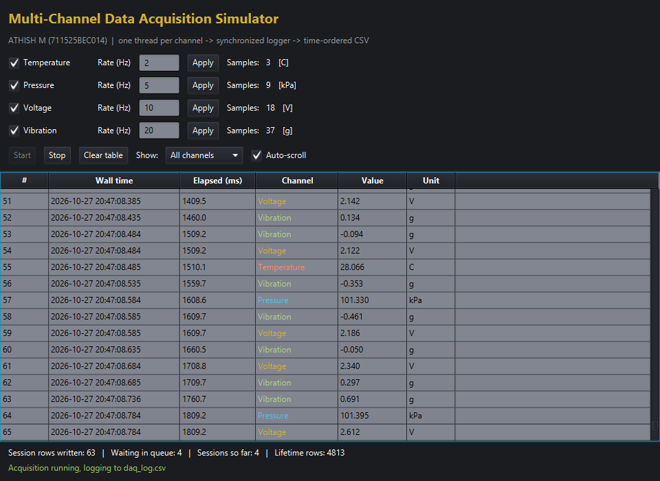
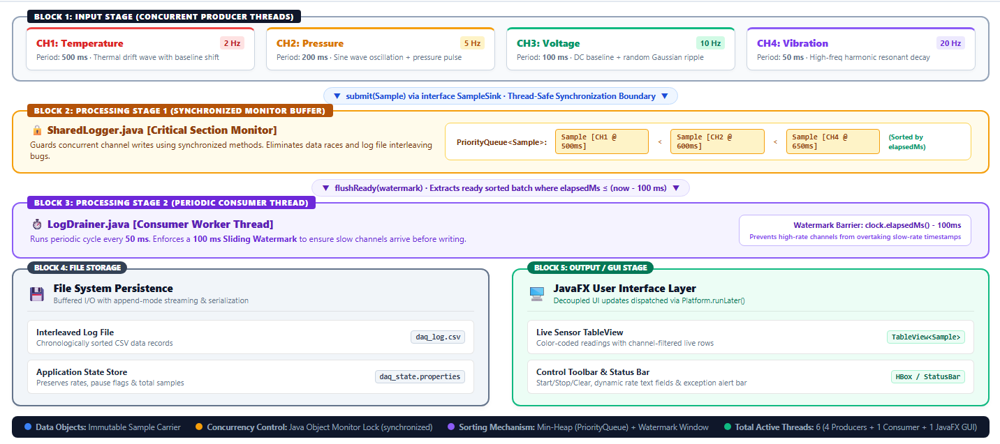
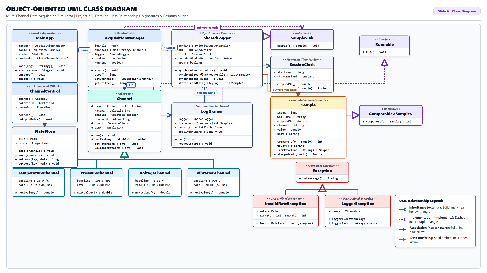

# Multi-Channel Data Acquisition Simulator
**Project 35 · B25CSI302 Java Programming · ATHISH M (711525BEC014) · Level 4 Advanced**

Four simulated input channels, each on its own thread at a different sampling rate, feed one
synchronized logger. The logger interleaves them into a single time-ordered CSV file and the
JavaFX table shows the rows live.

## Run
**Maven (easiest):** `mvn javafx:run`
**Without Maven:** download the JavaFX SDK 21 from gluonhq.com, then
`./run.sh /path/to/javafx-sdk-21/lib` (Linux/Mac) or `run.bat C:\javafx-sdk-21\lib` (Windows).
**Headless check (no window):** after compiling, `java -cp out com.athish.daq.DaqSelfCheck`
(compile `src/test` too). It runs 4 s and verifies order, counts and the rate exception.

Files created next to where you run it: `daq_log.csv` (the log) and `daq_state.properties` (saved state).

## Packages and classes (17 classes, ~900 lines)
| Package | Class | Role |
|---|---|---|
| model | `Sample` | immutable reading, `Comparable` by time, CSV in/out |
| core | `Channel` (abstract) | thread body: timing loop, rate, enable flag, counter |
| core | `SampleSink` (interface) | what a channel submits to |
| core | `SharedLogger` | **synchronized** priority queue + file writer |
| core | `LogDrainer` | thread that flushes ready samples to file and UI |
| core | `AcquisitionManager` | creates channels, starts/stops all threads |
| core | `SessionClock` | one shared time base |
| core | `LoggerException`, `InvalidRateException` | user-defined exceptions |
| channels | `TemperatureChannel` 2 Hz, `PressureChannel` 5 Hz, `VoltageChannel` 10 Hz, `VibrationChannel` 20 Hz | inheritance + overriding `nextValue()` |
| persist | `StateStore` | saves/loads settings with `Properties` |
| ui | `MainApp`, `ChannelControl` | JavaFX window and per-channel control row |

## How each requirement is met
- **Multiple threads:** 4 channel threads + 1 drainer thread + the JavaFX thread.
- **Synchronized shared logger:** `SharedLogger.submit()` and `flushReady()` are `synchronized`;
  the queue, file writer and counters are never touched outside them.
- **Time-ordered file:** samples wait in a `PriorityQueue` and are written only when older than a
  100 ms window, so a fast channel can never overtake an earlier sample from a slow one.
- **JavaFX table:** `TableView` with `FilteredList` (channel filter), colours per channel, auto-scroll.
- **File output:** append-mode CSV, one `# session started` line per run.
- **Events:** Start/Stop/Clear buttons, enable checkboxes, live rate fields, filter box.
- **State survives restart:** rates, enabled flags, session and lifetime counters are saved on Stop/close;
  the last 200 log rows are reloaded into the table at startup.
- **User-defined exceptions:** typing a rate outside 1–100 Hz throws `InvalidRateException`, caught in
  `ChannelControl` and shown in red.
- **Collections:** `PriorityQueue`, `LinkedHashMap`, `ArrayList`, `ArrayDeque`, `ObservableList`, `Properties`.

## System Architecture & UI Preview

### Real-Time JavaFX Acquisition Dashboard

### Module Architecture Block Diagram

### UML Class Hierarchy

## Documentation & Academic Deliverables
- **[Full Project Report](PROJECT_REPORT_711525BEC014.md)**: Comprehensive engineering report covering requirements, design patterns, threading architecture, and test cases.
- **[Presentation Slide Content](PPT_PRESENTATION_CONTENT.md)**: Complete slide-by-slide script and breakdown.
- **[Viva Voce Preparation Guide](VIVA_VOCE_PREPARATION.md)**: Detailed technical Q&A covering threading, JavaFX, OOP, and data structures.

## Demo script for the examiner
1. Launch, press **Start**: rows appear interleaved from four channels, # column and Elapsed increase together.
2. Change Vibration to 50 and Apply: it speeds up live. Type 500: red error from `InvalidRateException`.
3. Untick Pressure: it pauses. Use **Show:** to filter one channel.
4. Press **Stop**, close the app, reopen: rates restored, last rows reloaded, lifetime counter kept.
5. Open `daq_log.csv` in Excel and sort check: Elapsed is already ascending within each session.

## Likely viva questions
- *Why synchronized?* Four threads add to one `PriorityQueue` (not thread-safe) while the drainer polls it and writes the file.
- *Why the 100 ms window?* Threads timestamp then submit; the delay between those two steps is tiny but not zero, so we hold samples briefly until no earlier one can still arrive.
- *Why `volatile` on rate/enabled/running?* The UI thread writes them, channel threads read them; volatile guarantees visibility.
- *Why `Platform.runLater`?* JavaFX nodes may only be changed on the FX thread.

